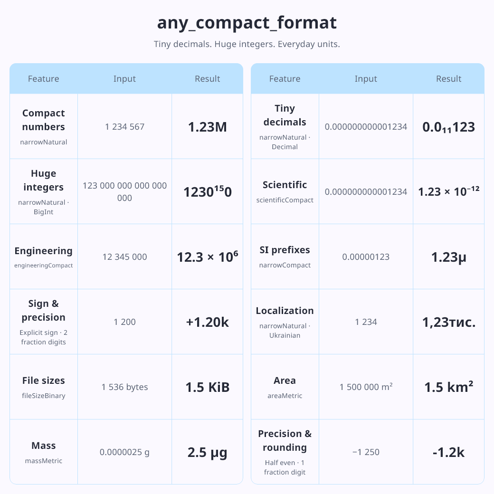

# any_compact_format

[](https://github.com/andry-brill/a-compact-format/actions/workflows/test.yml)

Compact numeric presentation for Flutter, using one exact decimal engine for locale patterns, custom intervals and mathematical notations. 
Rounding makes the displayed result approximate; retain original values for calculations and tooltips.



## Quick start

```dart
import 'package:any_compact_format/any_compact_format.dart';

// English `localizedCompact` by default
compactFormat(1234567); // 1.23M
compactFormat(1e-36); // 0.000000000000000000000000000000000001
compactFormat(BigInt.from(10).pow(36)); // 1000000000000000000000000T

final natural = CompactFormatOptions(format: narrowNatural);
compactFormat(1234567, options: natural); // 1.23M
compactFormat(1e-36, options: natural); // 0.0₃₅1
compactFormat(BigInt.from(10).pow(36), options: natural); // 10³⁶0

// Measurements: input in m² and grams. File sizes: input in bytes.
compactFormat(1500000, options: CompactFormatOptions(format: areaMetric)); // 1.5 km²
compactFormat(0.0000025, options: CompactFormatOptions(format: massMetric)); // 2.5 µg
compactFormat(1536, options: CompactFormatOptions(format: fileSizeBinary)); // 1.5 KiB
compactFormat(1536, options: CompactFormatOptions(format: fileSizeDecimal)); // 1.54 kB
```

> You might also like my other packages: [any_borders](https://pub.dev/packages/any_borders), [any_sparklines](https://pub.dev/packages/any_sparklines), [any_timeago](https://pub.dev/packages/any_timeago), [any_treemap](https://pub.dev/packages/any_treemap)

Inputs support `num`, `Decimal` and `BigInt`.

`localizedCompact` uses CLDR compact-number patterns supplied by `package:intl`. This package's decimal engine performs scaling and rounding, then selects the localized affixes and plural form.

For a chart axis or a small counter, pair `narrowCompact` with a locale’s `narrow()` helper. The table shows the standard labels from each locale and the package’s shorter display choices, in order from 10³ to 10¹².

| Locale | Standard labels | `narrow()` labels |
| --- | --- | --- |
| Russian | тыс. · млн · млрд · трлн | т · М · Мд · Т |
| Ukrainian | тис. · млн · млрд · трлн | т · М · Мд · Т |
| Polish | tys. · mln · mld · bln | t · M · Md · B |
| Italian | K · Mln · Mld · Bln | K · M · Md · B |
| French | k · M · Md · Bn | k · M · Md · B |
| Czech (`cs`) | tis. · mil. · mld. · bil. | t · M · Md · B |
| Slovak (`sk`) | tis. · mil. · mld. · bil. | t · M · Md · B |
| Hungarian (`hu`) | E · M · Mrd · B | E · M · Md · B |
| Romanian (`ro`) | K · mil. · mld. · tril. | K · M · Md · T |
| Bulgarian (`bg`) | хил. · млн. · млрд. · трлн. | х · М · Мд · Т |
| German (`de`) | Tsd. · Mio. · Mrd. · Bio. | Tsd · M · Md · B |
| Dutch (`nl`) | K · mln. · mld. · bln. | K · M · Md · B |
| Swedish (`sv`) | tn · mn · md · bn | tn · mn · md · bn |
| Spanish (`es`) | mil · M · mil M · B | k · M · G · B |
| Brazilian Portuguese (`pt`) | mil · mi · bi · tri | k · M · B · T |
| European Portuguese (`pt_pt`) | mil · M · mM · Bi | k · M · mM · Bi |
| Turkish (`tr`) | B · Mn · Mr · Tn | B · Mn · Mr · Tn |
| Indonesian (`id`) | rb · jt · M · T | rb · jt · M · T |
| Vietnamese (`vi`) | N · Tr · T · NT | N · Tr · T · NT |

```dart
import 'package:any_compact_format/any_compact_format.dart';
import 'package:any_compact_format/locales/fr.dart' as fr;
import 'package:any_compact_format/locales/it.dart' as it;
import 'package:any_compact_format/locales/pl.dart' as pl;
import 'package:any_compact_format/locales/ru.dart' as ru;
import 'package:any_compact_format/locales/uk.dart' as uk;

String label(num value, CompactLocale locale) =>
    compactFormat(value, options: CompactFormatOptions(locale: locale, format: narrowCompact));

void main() {
  label(1500, ru.narrow());        // 1,5т  (ru.locale: 1,5тыс.)
  label(1500, uk.narrow());        // 1,5т  (uk.locale: 1,5тис.)
  label(1500, pl.narrow());        // 1,5t  (pl.locale: 1,5tys.)
  label(1500000, it.narrow());     // 1,5M  (it.locale: 1,5Mln)
  label(1.5e12, fr.narrow());      // 1,5B  (fr.locale: 1,5Bn)
  label(1.5e9, pl.narrow(B: 'G')); // 1,5G
}
```

The optional arguments `k`, `M`, `B`, and `T` select 10³, 10⁶, 10⁹, and 10¹² respectively. For example, `B:` always overrides 10⁹, even in French where the narrow **output** `B` stands for *billion* (10¹²). `Md` keeps 10⁹ distinct from `M` for 10⁶. The helper changes only those four labels. The default `localizedCompact` format uses its own locale patterns.

Japanese, Simplified Chinese, Korean, and Hindi provide `narrowOverrides`, a list of intervals for their native magnitude boundaries. Merge these into the format you want to use for other numbers.

In an app, define the merged formats and locale options once at the top level, then pass those options to your root `CompactFormatProvider`. The example keeps the definitions in `main()` and passes options directly so you can see each result.

```dart
import 'package:any_compact_format/any_compact_format.dart';
import 'package:any_compact_format/locales/hi.dart' as hi;
import 'package:any_compact_format/locales/ja.dart' as ja;
import 'package:any_compact_format/locales/ko.dart' as ko;
import 'package:any_compact_format/locales/zh.dart' as zh;

void main() {
  // Japanese. Compare narrowNatural with the locale's native magnitude overrides.
  // Outside the overrides, japaneseFormat uses its narrowNatural base.
  final japaneseNatural = CompactFormatOptions(locale: ja.narrow(), format: narrowNatural);
  final japaneseFormat = CompactFormatDefinition(
    base: narrowNatural,
    overrides: ja.narrowOverrides,
  );
  final japanese = CompactFormatOptions(locale: ja.narrow(), format: japaneseFormat);
  print(compactFormat(15000, options: japaneseNatural)); // 15k
  print(compactFormat(15000, options: japanese)); // 1.5万
  print(compactFormat(1e12, options: japaneseNatural)); // 10¹²0
  print(compactFormat(1e12, options: japanese)); // 1兆
  print(compactFormat(1e-36, options: japanese)); // 0.0₃₅1

  // Simplified Chinese. Compare narrowNatural with the locale's native magnitude overrides.
  // Outside the overrides, chineseFormat uses its narrowNatural base.
  final chineseNatural = CompactFormatOptions(locale: zh.narrow(), format: narrowNatural);
  final chineseFormat = CompactFormatDefinition(
    base: narrowNatural,
    overrides: zh.narrowOverrides,
  );
  final chinese = CompactFormatOptions(locale: zh.narrow(), format: chineseFormat);
  print(compactFormat(1e8, options: chineseNatural)); // 100M
  print(compactFormat(1e8, options: chinese)); // 1亿
  print(compactFormat(1e12, options: chineseNatural)); // 10¹²0
  print(compactFormat(1e12, options: chinese)); // 1万亿
  print(compactFormat(1e-36, options: chinese)); // 0.0₃₅1

  // Korean. Compare narrowNatural with the locale's native magnitude overrides.
  // Outside the overrides, koreanFormat uses its narrowNatural base.
  final koreanNatural = CompactFormatOptions(locale: ko.narrow(), format: narrowNatural);
  final koreanFormat = CompactFormatDefinition(
    base: narrowNatural,
    overrides: ko.narrowOverrides,
  );
  final korean = CompactFormatOptions(locale: ko.narrow(), format: koreanFormat);
  print(compactFormat(15000, options: koreanNatural)); // 15천
  print(compactFormat(15000, options: korean)); // 1.5만
  print(compactFormat(1e8, options: koreanNatural)); // 100M
  print(compactFormat(1e8, options: korean)); // 1억
  print(compactFormat(1e-36, options: korean)); // 0.0₃₅1

  // Hindi. Compare narrowNatural with the locale's native magnitude overrides.
  // Outside the overrides, hindiFormat uses its narrowNatural base.
  final hindiNatural = CompactFormatOptions(locale: hi.narrow(), format: narrowNatural);
  final hindiFormat = CompactFormatDefinition(
    base: narrowNatural,
    overrides: hi.narrowOverrides,
  );
  final hindi = CompactFormatOptions(locale: hi.narrow(), format: hindiFormat);
  print(compactFormat(150000, options: hindiNatural)); // 150ह
  print(compactFormat(150000, options: hindi)); // 1.5लाख
  print(compactFormat(1e7, options: hindiNatural)); // 10M
  print(compactFormat(1e7, options: hindi)); // 1क॰
  print(compactFormat(1e-36, options: hindi)); // 0.0₃₅1

  // Merge the Japanese overrides into narrowCompact. Smaller numbers follow
  // narrowCompact, including its µ suffix for millionths.
  final japaneseCompact = narrowCompact.copyWith(overrides: ja.narrowOverrides);
  final compact = japanese.copyWith(format: japaneseCompact);
  print(compactFormat(0.0000015, options: compact)); // 1.5µ
  print(compactFormat(15000, options: compact)); // 1.5万

  // Use only the Japanese overrides, with no base format. Below 10⁴,
  // defaultFallbackFormatter produces ungrouped localized decimals with
  // at most three fractional digits. Precision, rounding, and sign options apply.
  final overridesOnly = CompactFormatDefinition(overrides: ja.narrowOverrides);
  final standalone = japanese.copyWith(format: overridesOnly);
  print(compactFormat(15000, options: standalone)); // 1.5万
  print(compactFormat(1500, options: standalone)); // 1500
  print(compactFormat(1234.56789, options: standalone)); // 1234.568
  print(compactFormat(1e-36, options: standalone)); // 0
}
```

## Installation

```sh
flutter pub add any_compact_format
```

## Explicit locale configurations

`CompactLocale` contains one numeric `Locale` and one immutable `Map<CompactLabel, String>`. Import a locale configuration and pass it in `CompactFormatOptions.locale`:

```dart
import 'package:any_compact_format/any_compact_format.dart';
import 'package:any_compact_format/locales/en.dart' as en;
import 'package:any_compact_format/locales/uk.dart' as uk;
import 'package:flutter/widgets.dart';

final custom = uk.locale.copyWith(
  locale: const Locale('uk', 'UA'),
  labels: {CompactLabel.kilobyte: 'кБ', CompactLabel.million: 'млн'},
);
final options = CompactFormatOptions(locale: custom, format: fileSizeDecimal);
compactFormat(1500, options: options); // 1,5 кБ
compactFormat(1500, options: options.copyWith(locale: en.locale)); // 1.5 kB
```

`copyWith(labels: {...})` overrides only supplied keys within the selected configuration; omitted keys remain unchanged. `copyWith(locale: ...)` explicitly changes numeric conventions while retaining the labels, for example a regional variant. There is no locale registry, defaults map, language lookup or cross-language label merge. Selecting `uk.locale` replaces `en.locale` as a whole, including in nested providers and call overrides.

Missing label keys use the interval's literal `prefix`/`suffix` fallback, or an empty string if none was provided. There is no English label fallback. An explicit empty string hides the label and its separator. Numeric formatting alone falls back to supported parent locales and then English; it keeps the selected configuration's labels.

`CompactLabel` constants identify meanings: `byte` and `billion` are separate keys even though both can display B. For custom keys, use `const CompactLabel('inventory.crate')`. Construct a custom configuration with `CompactLocale(locale: ..., labels: {...})`; it snapshots its map. Configurations compare by content and have no mutable global state.

Bundled locale libraries expose `locale` and `narrow()` under `locales/<code>.dart`. Available codes are `bg`, `cs`, `de`, `en`, `es`, `fr`, `hi`, `hu`, `id`, `it`, `ja`, `ko`, `nl`, `pl`, `pt` (Brazil), `pt_pt` (Portugal), `ro`, `ru`, `sk`, `sv`, `tr`, `uk`, `vi`, and `zh` (Simplified Chinese). Direct calls, standalone widgets and root providers default to `en.locale`. A nested provider inherits its parent's locale unless you supply one explicitly.

All narrow, file-size and measurement presets use semantic keys. `localizedCompact` retains its CLDR patterns; label overrides do not rewrite its output or mathematical notation. Labels are compact strings without a plural API. For custom intervals, `prefixLabel`/`suffixLabel` select keys and `separator` controls spacing between nonempty labels and the number. Keys, literal fallbacks and separators survive interval splitting. Callbacks can use `context.defaultText` to obtain resolved labels.

### Custom labels and formatters

Define a semantic key once, add its abbreviation to each locale you use, and reference that key from an interval. Use an application-specific namespace to avoid collisions. Two `CompactLabel` instances with the same key string identify the same label; the rendered text is not the key.

```dart
import 'package:any_compact_format/any_compact_format.dart';
import 'package:any_compact_format/locales/en.dart' as en;
import 'package:any_compact_format/locales/uk.dart' as uk;

const crate = CompactLabel('inventory.crate');
final english = en.locale.copyWith(labels: {crate: 'crt'});
final ukrainian = uk.locale.copyWith(labels: {crate: 'ящ.'});

// Input is individual items. One crate contains 100 items.
final crates = CompactFormatDefinition(
  formatZero: true,
  overrides: const [
    CompactInterval(
      scale: CompactPower(power: 2),
      suffixLabel: crate,
      suffix: 'crate', // Literal fallback if the selected locale lacks this key.
      separator: ' ',
    ),
  ],
);
final options = CompactFormatOptions(locale: english, format: crates);
compactFormat(250, options: options); // 2.5 crt
compactFormat(250, options: options.copyWith(locale: ukrainian)); // 2,5 ящ.
compactFormat(0, options: options); // 0 crt
compactFormat(250, options: options.copyWith(locale: en.locale)); // 2.5 crate
compactFormat(
  250,
  options: options.copyWith(locale: english.copyWith(labels: {crate: ''})),
); // 2.5
```

A single interval without bounds covers every magnitude. Its `scale` is independent of its label: changing `crt` to another abbreviation does not change the 100-item divisor. `formatZero: true` retains the unit for zero; otherwise zero bypasses interval affixes and callbacks.

`prefixLabel` works the same way for text before the number. `prefix`/`suffix` are literal fallbacks, not keys. `separator` defaults to an empty string and is inserted between each nonempty affix and the number. Keep spacing outside translated labels; use `' '` or `'\u00a0'` for a normal or nonbreaking space. A missing key uses the literal fallback, or nothing when that fallback is empty. An explicitly empty translation hides the label even when a literal fallback exists, and adds no separator. No other locale is consulted.

For custom rendering, attach a callback to the interval. `context.defaultText` already contains the localized number, resolved labels and separators:

```dart
final approximateCrates = CompactFormatDefinition(
  formatZero: true,
  overrides: [
    CompactInterval(
      scale: const CompactPower(power: 2),
      suffixLabel: crate,
      separator: ' ',
      formatter: (context) => '≈ ${context.defaultText}',
    ),
  ],
);
compactFormat(250, options: options.copyWith(format: approximateCrates)); // ≈ 2.5 crt
```

Use `context.numberText` for the already-rounded number alone, or `context.options.locale!.resolve(crate, fallback: 'crate')` to resolve a key yourself. `context.locale` is the numeric formatter's resolved locale-name string; `context.options.locale` is the selected `CompactLocale` and retains its labels even when numeric formatting falls back. Returning null from an interval callback keeps its default text; returning an empty string hides the entire output.

The same configuration can be inherited by widgets:

```dart
CompactFormatProvider(
  options: CompactFormatOptions(locale: ukrainian, format: crates),
  // Uses context.compactFormat(250) with the inherited locale and format.
  child: const CompactFormatText(250), // 2,5 ящ.
);
```

A child locale replaces the complete parent locale. Start from `uk.locale.copyWith(...)` or your own existing configuration when overriding individual keys; constructing a new `CompactLocale` with only your custom keys does not inherit built-in labels. Custom keys affect only intervals or callbacks that reference them. They do not change `localizedCompact`'s CLDR patterns.

## Metric units

| Preset | Required input unit | Display sequence |
| --- | --- | --- |
| `lengthMetric` | metres | µm, mm, cm, m, km |
| `areaMetric` | square metres | mm², cm², m², km² |
| `volumeMetric` | cubic metres | mm³, cm³, m³, km³ |
| `volumeLitres` | litres | µL, mL, cL, dL, L, hL, kL |
| `massMetric` | grams | µg, mg, g, kg, t |

Inputs are already in the listed base unit; these presets do not infer a source unit. `1 km² = 10⁶ m²`, `1 cm³ = 10⁻⁶ m³`, and `1 t = 10⁶ g`. Bounds and divisors use `CompactPower`; measurements and file sizes share one interval builder and the same exact decimal engine. Values below/above a sequence retain its smallest/largest unit. Zero retains the input unit (`0 m`, `0 m²`, `0 m³`, `0 L`, `0 g`), including after interval splitting. Nonzero values that round to zero retain their selected unit.

Significant/fraction precision, rounding, threshold promotion, negative deltas, Decimal and BigInt inputs work as for other presets. Default precision is three significant digits. All labels remain compact strings, without a plural API. The example includes a sample set for each measurement, explicit input-unit descriptions, negative/extreme values and the en/uk_UA locale selector.

## Exact inputs, notation presets and rounding

All entry points accept `num`, `Decimal` (re-exported from the `decimal` dependency) and Dart’s native arbitrary-precision `BigInt`. Strings are not implicitly parsed. Construct `Decimal` or `BigInt` from a string to preserve every input digit. Doubles enter through their shortest decimal string; precision already lost before formatting cannot be recovered.

```dart
final options = CompactFormatOptions(
  locale: en.locale,
  format: narrowNatural,
  precision: const CompactPrecision.significant(maximum: 3),
  rounding: CompactRounding.halfEven,
);
compactFormat(Decimal.parse('0.00000123456'), options: options); // 0.0₅123
compactFormat(BigInt.parse('2130000000'), options: options);    // 2.13B
compactFormat(BigInt.from(10).pow(400), options: options);      // 10⁴⁰⁰0
```

| Preset | Small-value behavior | Large-value behavior |
| --- | --- | --- |
| `localizedCompact` | Localized decimals | Locale-specific units from intl |
| `narrowCompact` | SI-inspired letters down to q | k, M, B, T … Q; intl fallback |
| `subscriptCompact` | Subscript leading-zero counts | intl units |
| `zeroSubscriptCompact` | `0.00000123 → 0.0₅123` | `213000000 → 2130₆0` |
| `zeroSuperscriptCompact` | `0.00000123 → 0.0⁵123` | `213000000 → 2130⁶0` |
| `scientificCompact` | `0.00000123 → 1.23 × 10⁻⁶` | `2130000000 → 2.13 × 10⁹` |
| `engineeringCompact` | `0.0000123 → 12.3 × 10⁻⁶` | `21300000000 → 21.3 × 10⁹` |
| `narrowNatural` | Subscript leading-zero counts below one | k/M/B, then superscript trailing-zero counts from 10¹² |

Zero counting starts at four consecutive zeros by default. For leading zeros the count includes the displayed zero: `0.0₅123` has five zeros before 123. For integer trailing zeros, the count represents the **entire run**: `2130₆0` and `2130⁶0` mean 213 followed by exactly six zeros (`213000000`). Both visible zeros mark that run; neither adds an extra zero. Thus `2130000000` uses a count of seven: `2130₇0` / `2130⁷0`. These are zero-run markers, not powers. Decimal fractional padding is never compressed; for example, exact two-fraction precision retains `10000.00`. Both scripts support every digit 0–9 and multi-digit counts.

`CompactNotation.decimal()`, `.zeroCount(script:, sides:, minimumZeros:)`, `.scientific()` and `.engineering()` are reusable on either a definition or an interval. `ZeroCountSides` selects leading, trailing or both. `minimumZeros` defaults to 4 and must be at least 2; invalid notation settings throw `ArgumentError`. Scientific/engineering notation chooses its own scale; combining it with an interval `scale` other than one is invalid. Definition precedence is intervals → callback → notation → base → fallbackFormatter → ordinary decimals. `copyWith(overrides:)` preserves notation, including when splitting intervals.

The shared engine normalizes an exact signed BigInt coefficient and a decimal exponent, selects a scale, rounds once from the original value, resolves any carry, pads, then renders the notation and locale. It never scales or rounds through binary floating point. Significant precision counts coefficient digits; fraction precision counts coefficient decimal places. Exponent and zero-count marker digits do not count toward precision. Scientific carry renormalizes to one integer digit; engineering exponents stay multiples of three. Fraction precision on an unscaled tiny value can round it to zero, while significant precision preserves its magnitude.

`CompactRounding` applies to every preset and interval:

| Mode | Exact 1.25, at one fractional digit | Exact −1.25 |
| --- | --- | --- |
| `halfAwayFromZero` (default) | 1.3 | −1.3 |
| `halfEven` | 1.2 | −1.2 |
| `towardZero` | 1.2 | −1.2 |
| `floor` | 1.2 | −1.3 |
| `ceil` | 1.3 | −1.2 |

Locale compact affixes and plural forms come from intl’s public CLDR data; numeric rounding uses this engine. `localizedCompact` uses exact decimal scaling and rounding rather than binary floating-point arithmetic. For example, German 999950 rounds to `1 Mio.` at three significant digits. Plural category lookup alone uses a numeric projection of the rounded coefficient; coefficients whose scaled plural operands exceed safe integer range, or whose displayed fraction exceeds 15 digits, use the locale’s `other` form. Rendering remains exact. Unicode exponent/count digits stay in their selected script; ordinary digits, decimal separators and signs follow the locale.

## Powers and file sizes

Use independent `CompactPower` values for each bound and divisor:

```dart
const interval = CompactInterval(
  from: CompactPower(base: 1024, power: 1),
  to: CompactPower(base: 1024, power: 2),
  scale: CompactPower(base: 1024, power: 1),
  suffix: ' KiB',
);
// Matches [1024, 1048576), divides by 1024, then rounds and localizes.
```

`CompactPower(power: 3)` defaults to base 10, so it means 1000. `CompactPower.one` is the identity divisor. `compareTo` and ordering operators compare exact magnitudes across bases, while equality and hashing retain the authored base/power pair: `2^10` and `1024^1` compare as equal magnitudes but are different configuration values. Bounds and divisors may use different supported bases. Missing bounds retain the constructor/merge inference rules below; explicit open ends use `CompactPower.negativeInfinity` / `.positiveInfinity`.

```dart
final bytes = CompactFormatOptions(
  locale: en.locale,
  format: fileSizeBinary,
  precision: const CompactPrecision.fraction(maximum: 2),
  rounding: CompactRounding.halfEven,
);
compactFormat(BigInt.from(1536), options: bytes); // 1.5 KiB
compactFormat(1048575, options: bytes);           // 1 MiB (rounded promotion)
compactFormat(-1536, options: bytes);            // -1.5 KiB
compactFormat(0, options: bytes);                // 0 B
compactFormat(1500, options: bytes.copyWith(format: fileSizeDecimal)); // 1.5 kB
```

`fileSizeBinary` uses 1024-byte steps through B, KiB, MiB, GiB, TiB, PiB, EiB, ZiB and YiB. `fileSizeDecimal` uses 1000-byte steps through B, kB, MB, GB, TB, PB, EB, ZB, YB, RB and QB. Values above the last unit remain in that unit. Unit labels resolve only through the selected `CompactLocale`. Bundled locales supply all file-size keys; a custom locale missing a key produces no unit label because these presets have no literal fallback. The separating space is defined by the preset; number digits, decimal separators and signs follow the locale. Negative sizes represent deltas; fractional bytes are accepted.

Both presets use the shared precision and rounding policy, defaulting to three significant digits, including the B interval. For example, default precision rounds 1023 bytes to `1020 B`; choose fraction precision to keep integer bytes and limit decimals after scaling. At two fractional digits, 1048575 bytes rounds from 1023.999... KiB to `1 MiB`, recalculated from the original input. Scaling and threshold comparison remain exact for Decimal and BigInt.

## Subscript zero counts

Merge `subscriptOverrides` into any format to shorten tiny values without SI subunit symbols:

```dart
final format = narrowCompact.copyWith(overrides: subscriptOverrides);
final options = CompactFormatOptions(locale: en.locale, format: format);
compactFormat(1e-36, options: options);       // 0.0₃₅1
compactFormat(0.000001234, options: options); // 0.0₅123
compactFormat(0.001234, options: options);    // 0.00123
compactFormat(-0.000001, options: options);  // -0.0₅1
compactFormat(1234567, options: options);     // 1.23M
```

The reusable immutable override explicitly spans exponents `[-infinity, 0)`, replacing every smaller-number interval, including those below the target's original minimum. It uses scale exponent zero and defaults to three significant digits. After rounding, runs of at least four zeros immediately after the decimal separator become one zero followed by the total zero count. Thus `0.0₃₅1` means 35 zeros before the first significant digit, not 35 additional zeros. Rounding can reduce the count or remove the subscript entirely. Values of magnitude one or greater retain the target's formatting; existing presets and global defaults do not change. `subscriptCompact` remains a convenience for `localizedCompact.copyWith(overrides: subscriptOverrides)`.

The count uses plain Unicode characters `₀₁₂₃₄₅₆₇₈₉` (U+2080–U+2089), not rich text. Ordinary digits, decimal separators and signs follow the locale (`0,0₃₅1` in Norwegian); the count always uses Unicode subscript digits. The selected font or its fallback must support them. Supply an expanded `semanticsLabel` on `CompactFormatText` when needed for accessible reading, and retain the original value for exact tooltips/copying. This notation is display text, not numeric parser input.

Existing `precision` options apply before compression, including minimum padding. Explicit fractional precision can round a tiny value to zero; use significant precision to preserve its magnitude. Compressing zeros itself is lossless, but the configured numeric rounding still applies. Custom definition callbacks can use `context.formatSubscript(value)` with the same rules and no large-number abbreviation.

## Custom formats

Override millions and use intl elsewhere:

```dart
final millions = CompactFormatDefinition(
  base: localizedCompact,
  overrides: [
    CompactInterval(
      from: CompactPower(power: 6),
      to: CompactPower(power: 9),
      scale: CompactPower(power: 6),
      suffix: ' million',
    ),
  ],
);
final options = CompactFormatOptions(locale: en.locale, format: millions);
compactFormat(1200, options: options);       // 1.2K
compactFormat(1234567, options: options);    // 1.23 million
compactFormat(999950000, options: options);  // 1B (rounding leaves the override)
compactFormat(1000000000, options: options); // 1B
```

At each definition, priority is **matching interval → formatter → notation → base → fallbackFormatter → ordinary decimal**. Selection starts with the original absolute magnitude, then rounds the scaled input using the requested precision (three significant digits by default). If the rounded magnitude reaches the upper bound, selection promotes to the local interval containing that magnitude. For example, narrow `999950` becomes `1M`.

Each candidate rescales and rounds the **original input**, avoiding accumulated rounding. Promotion only moves upward; rounding down or to zero never demotes. An open upper bound keeps its unit, so an open millions interval can still produce `1000 million`.

If the original or promoted magnitude falls in a gap or beyond the local overrides, use the definition formatter, then its notation, then base, then the options fallbackFormatter, then decimal fallback. Never snap across a gap to the next interval. Fallback receives the original input and applies its own selection and precision; it does not inherit the provisional rounded value.

The final decimal fallback calls `context.formatDecimal(value)`. It renders an unscaled, ungrouped decimal through the package's decimal engine, localizes digits, the decimal separator and sign, and applies `precision`, `rounding` and `explicitSign`. Its default precision is at most three fractional digits. For example, `1234.56789` becomes `1234.568` in English or `1234,568` in French, and `1e-36` becomes `0`. Dart's `number.toString()` has its own precision and notation rules, so it can produce different text.

Omitting `CompactFormatOptions.format` selects the inherited provider format for context-aware calls, or `localizedCompact` for standalone calls. The decimal fallback above applies within an explicitly selected format after its intervals, formatter, notation and base have been exhausted.

Set `CompactFormatOptions.fallbackFormatter` to customize that final fallback. Define the options once and supply them through `CompactFormatProvider`, or pass them to an individual call.

The `fallbackFormatter` getter always returns a function, defaulting to `defaultFallbackFormatter`, which calls `context.formatDecimal(context.input)`. Passing `null` to the constructor or `copyWith` clears the stored override so options can inherit a provider's callback when merged. To explicitly restore ordinary decimals for a child or individual call, pass `const CompactFormatOptions(fallbackFormatter: defaultFallbackFormatter)`. The top-level function can be used as a constant function tear-off.

```dart
final options = CompactFormatOptions(
  locale: ja.locale,
  format: CompactFormatDefinition(overrides: ja.narrowOverrides),
  fallbackFormatter: (context) => context.input.toString(),
);
compactFormat(15000, options: options); // 1.5万
compactFormat(1e-36, options: options); // 1e-36
compactFormat(1234.56789, options: options); // 1234.56789
```

The callback receives the original input and resolved options. Returning `null` uses the ordinary decimal fallback, and returning an empty string hides the output. You can call `context.formatDecimal(context.input)` or `context.formatNotation(...)` inside it. These helpers apply the engine's precision and localization directly. Zero also uses the callback when the selected format has `formatZero: false`. NaN and infinity use their localized special-number rendering.

If you only need a different decimal precision, set `precision: const CompactPrecision.fraction(maximum: 6)` in the options. That precision also applies to the selected format's intervals. A custom fallback callback controls its own output, including any rounding or localization.

Intervals match `[from, to)` by exact absolute magnitude. Each endpoint is a `CompactPower(base:, power:)`; the independent `scale` is the divisor and defaults to `CompactPower.one`. Use `from`, `to` and `scale` for both decimal and binary powers. Use `separator` for spacing between nonempty labels and the number; literal affixes can also include intentional spacing.

### Open and inferred boundaries

An omitted first lower bound means zero; an omitted last upper bound means infinity. Missing inner bounds use the explicit endpoint of the neighbouring local interval:

```dart
final progression = CompactFormatDefinition(overrides: [
  CompactInterval(to: CompactPower(power: 3), scale: CompactPower(power: 0)),
  CompactInterval(scale: CompactPower(power: 3), suffix: 'k'),
  CompactInterval(from: CompactPower(power: 6), scale: CompactPower(power: 6), suffix: 'M'),
]);
// [0, 1e3), [1e3, 1e6), [1e6, infinity).
```

Constructor intervals must be ordered, nonempty and nonoverlapping. If both sides omit a shared boundary, construction throws `ArgumentError`. Explicit gaps use the fallback chain; base intervals do not affect inference. Finite powers must be integers. Bases are integers from 2 through 1000000000 whose only prime factors are 2 and 5; after raising the base, each factor count is limited to 100000. This supports decimal and binary scales, including 1000 and 1024, with exact finite decimal division. Other bases, fractional powers, NaN and invalid infinite bounds are rejected. `CompactPower.negativeInfinity` explicitly opens a lower bound (magnitude zero), and `CompactPower.positiveInfinity` opens an upper bound. Infinite scales are invalid. For base 10, the supported finite power range is -100000..100000.

### Merging overrides with copyWith

`format.copyWith(overrides: changes)` merges into the target definition's local intervals. It retains the existing definition formatter, notation, zero policy and base fallback; it does not create a new layer or flatten the base. The target is immutable.

Each incoming override must supply at least one endpoint. Omission means inference from the original target's resolved local boundaries (both starts and ends), while explicit infinity keeps that end open:

| Incoming bounds | Resolution |
| --- | --- |
| `to: t`, omitted `from` | Closest target boundary strictly below `t`, or negative infinity if none exists. |
| `from: f`, omitted `to` | Closest target boundary strictly above `f`, or positive infinity if none exists. |
| Both supplied | Use exactly those bounds, including explicit infinities. |
| Both omitted | Throw `ArgumentError`. |

For a target with exponent intervals `[-6, -3)`, `[-3, 0)`, `[0, 3)`, `[3, 6)`:

```dart
// Replace only [-3, 0); the omitted bound finds the closest target boundary.
final nearest = format.copyWith(overrides: [
  CompactInterval(to: CompactPower(power: 0), scale: CompactPower(power: 0)),
]);

// Replace ALL subunit intervals, including magnitudes below 1e-6.
final allSmall = format.copyWith(overrides: [
  CompactInterval(
    from: CompactPower.negativeInfinity,
    to: CompactPower(power: 0),
    scale: CompactPower(power: 0),
    notation: const CompactNotation.zeroCount(sides: ZeroCountSides.leading),
  ),
]);
// Equivalent reusable choice: format.copyWith(overrides: subscriptOverrides).
```

Comparison and inference use exact values across bases: `CompactPower(base: 2, power: 10)` and `CompactPower(base: 1024, power: 1)` describe the same boundary. They cannot form a nonempty interval, and touching intervals at these equivalent endpoints do not overlap. Power equality/hash remain structural to preserve authored metadata; `compareTo` and ordering operators compare their magnitudes.

Every range is half-open: an override owns its lower boundary but not its upper boundary. Covered target intervals are replaced; partially covered intervals are trimmed or split, retaining their scale, notation, affixes and callback. Overrides can fill gaps or extend beyond the previous ends. The merged intervals have explicit bounds and remain ordered and immutable. Rounding promotion uses the merged intervals as usual.

All missing bounds in one call resolve against the same original target, before any replacement. Incoming overrides may be unordered, but overlapping overrides are rejected; touching intervals are allowed. Reversed or empty ranges are rejected. Omitting `overrides` or supplying an empty iterable returns the original definition. A subsequent `copyWith` resolves against the previous merge's resulting boundaries.

### Callbacks

Definitions and intervals accept a `CompactFormatter`, returning complete text or null:

```dart
final custom = CompactFormatDefinition(
  base: localizedCompact,
  overrides: [
    CompactInterval(
      from: CompactPower(power: 6),
      to: CompactPower(power: 9),
      scale: CompactPower(power: 6),
      suffix: ' million',
      formatter: (context) => '${context.defaultText} approximately',
    ),
  ],
  formatter: (context) => context.input == 42 ? 'the answer' : null,
);
```

An interval callback returning null keeps its default number and affixes. A definition callback returning null uses its notation, then its base, then the options fallbackFormatter and ordinary decimals. Empty strings are final output; exceptions propagate.

Only the final selected interval callback runs, once. The library supplies `CompactFormattingContext` with original `input`, rounded scaled `value` for intervals (original value for definition callbacks), resolved `locale`, `options`, and optional authored `interval`. `input` and `value` have type `Object` to accept all supported inputs. num inputs retain a num-valued interval projection when representable; Decimal/BigInt interval inputs produce Decimal. Use `decimalInput` and `decimalValue` for type-independent exact comparisons and calculations, for example `context.decimalValue == Decimal.one`.

`numberText` preserves selected rounding and padding; `defaultText` adds affixes. Callback text is final and never parsed or used for promotion. `formatDecimal(Object)`, `formatCompact(Object)`, `formatSubscript(Object)` and `formatNotation(Object, CompactNotation)` use the same engine/settings. Decimal helpers default to three significant digits inside intervals, or at most three fractional digits outside intervals; explicit precision overrides this. Notation and compact helpers default to three significant digits.

## Options and Flutter

Options merge field by field: **explicit call → nearest provider → parent providers → defaults**. Null fields inherit. `options.copyWith(field: null)` clears a local override; `options.merge(overrides)` applies non-null fields. Locale configurations are replaced atomically, without merging labels. Numeric formatting alone tries the requested numeric locale, supported parents, then English.

- `CompactPrecision.significant(minimum: 1, maximum: 3)` controls significant digits (1–1000).
- `CompactPrecision.fraction(minimum: 0, maximum: 2)` controls fractional digits (0–1000).
- Minimum precision pads zeroes; invalid precision throws. `explicitSign` defaults to false; true adds a localized positive sign.

```dart
CompactFormatProvider(
  options: CompactFormatOptions(locale: en.locale, format: narrowCompact),
  child: CompactFormatProvider(
    options: const CompactFormatOptions(precision: CompactPrecision.significant(maximum: 2)),
    child: const CompactFormatText(1234567), // 1.2M
  ),
);
```

The root provider defaults to English. A nested provider inherits its parent locale unless explicitly replaced. `CompactFormatText` forwards standard `Text` styling, layout and semantics settings.

To use the merged options in your own widget, call `CompactFormatProvider.of(context)` in a descendant's `build` method. Flutter rebuilds that widget when the inherited options change.

```dart
class ViewCount extends StatelessWidget {
  const ViewCount(this.count, {super.key});

  final int count;

  @override
  Widget build(BuildContext context) {
    final options = CompactFormatProvider.of(context);
    final formatted = compactFormat(count, options: options);
    return Text('Views: $formatted');
  }
}
```

If the widget only needs the formatted string, use `context.compactFormat(count)` directly. It uses the package defaults when there is no provider. To read the options themselves when the provider is optional, use `CompactFormatProvider.maybeOf(context)`, which returns `null` in that case.

## API reference

| API | Purpose |
| --- | --- |
| `compactFormat(Object, {options}) → String` | Public formatting entry point. |
| `CompactLocale({locale, labels})` | One immutable numeric locale and label map; `copyWith` overrides selected labels. |
| `CompactLabel(key)` | Semantic label identity, with built-in keys and support for custom keys. |
| `CompactLocale.copyWith({locale, labels})`, `.resolve(key, {fallback})` | Override selected labels or numeric conventions; resolve one key without cross-language fallback. |
| `CompactFormatDefinition({base, overrides, formatter, notation, formatZero})` | Immutable format; compose through `base`. |
| `CompactFormatDefinition.copyWith({overrides})` | Merge ranges into local intervals, inferring omitted endpoints from the original target. |
| `CompactPower({base: 10, required power})` | Exact magnitude for a bound or divisor; explicit infinite-bound constants and value-based comparison. |
| `fileSizeBinary`, `fileSizeDecimal` | Byte-size definitions with 1024/1000 steps, respectively. |
| `lengthMetric`, `areaMetric`, `volumeMetric`, `volumeLitres`, `massMetric` | Measurement definitions; input units are m, m², m³, L and g. |
| `CompactNotation`, `CompactScript`, `ZeroCountSides` | Decimal, zero-count, scientific and engineering presentation settings. |
| `CompactRounding` | Five shared rounding modes for all presets and intervals. |
| `subscriptOverrides` | Reusable explicit negative-infinity-to-zero exponent override for tiny values. |
| `CompactInterval({from, to, scale, notation, prefix, suffix, prefixLabel, suffixLabel, separator, formatter})` | Input range and presentation. |
| `CompactFormatter` | `(CompactFormattingContext) → String?`. |
| `CompactFormattingContext` | Original/exact values, selected interval, resolved numeric locale, selected options, rendered text and formatting helpers; constructed by the library. |
| `CompactFormatOptions({CompactLocale? locale, format, precision, explicitSign, rounding, fallbackFormatter})` | Call or provider settings, with `merge` and `copyWith`. |
| `CompactPrecision.significant(...)`, `.fraction(...)` | Precision settings, with `copyWith` and `validate`. |
| `CompactFormatProvider({options, required child})` | Inherited settings. `of(context)` returns merged options or throws; `maybeOf(context)` returns null when absent. |
| `BuildContext.compactFormat(Object, {options})` | Format using inherited and explicit options. |
| `CompactFormatText(value, {options, …Text settings})` | Render as Flutter Text. |

Construct new definitions/intervals or merge intervals with `copyWith` to change configuration. Definitions use identity equality; reuse them across builds. Intervals, options, precision, notations, label keys and locale configurations use value equality. Locale label maps are immutable snapshots. Constructor callbacks see authored intervals with omitted bounds intact; merged callbacks see intervals with their resulting explicit bounds.

## Numeric behavior

Zero and negative zero normally use localized decimal rendering, bypassing callbacks and affixes. Definitions can opt into interval/callback formatting of zero with `formatZero: true`, as the file-size presets do for `0 B`. This setting inherits from `base` when omitted, can be explicitly disabled, and survives `copyWith`. NaN and infinity always use localized decimal rendering without unit affixes. Rounding to zero retains a selected interval’s affixes and normalizes the sign. Decimal and BigInt inputs are finite; only num can carry NaN or infinity. Exponent/scale selection and rounding have no double overflow or underflow. Very long inputs/output still require memory proportional to their digit count.

This API returns display strings, not parser input or an exact numeric result. Rounding can discard digits even when the input is exact. Use Decimal/BigInt for exact inputs on native and web; large web int literals and doubles can already have lost precision. The shortest representation of `double.minPositive` is `5e-324`, so its three-significant-digit rendering is based on 5, rather than reconstructing the binary approximation.

## Example

The [example app](example/lib/main.dart) compares notation presets, file sizes, and metric units. Explore positive/negative values, exponents −36…+36, tiny decimals, large BigInts, and rounding boundaries. Controls select sample sets, locale, precision, and rounding.

From the `example` directory:

```sh
flutter pub get
flutter run -d chrome
```

## Development

From the package directory:

```sh
flutter pub get
flutter analyze lib test
flutter test
```

From `example`:

```sh
flutter pub get
flutter analyze
flutter test
flutter build web
```

## License

See [LICENSE](LICENSE) for usage terms.
